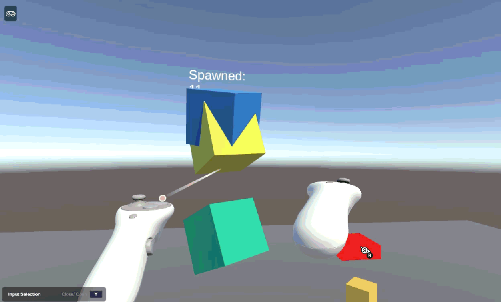

# XR Sandbox

A small VR interaction sandbox built in Unity with the XR Interaction Toolkit. You can grab and throw objects with the controller ray, and press a button that spawns new grabbable objects in random colours while a world-space counter keeps track.



## Built with

- Unity 6.3 LTS (Universal Render Pipeline)
- XR Interaction Toolkit
- OpenXR
- C#
- TextMeshPro

## Features

- **Grab and throw:** cubes use `XR Grab Interactable` with Rigidbody physics, so they can be picked up with the controller ray and thrown.
- **Event-driven spawn button:** an `XR Simple Interactable` fires its Select Entered event into a custom C# script that instantiates a new grabbable cube with a random colour and rotation.
- **World-space UI:** a TextMeshPro counter on a world-space canvas updates each time a cube is spawned.
- **Simulator testing:** the scene runs in the XR Interaction Simulator, so it can be tested with keyboard and mouse without a headset.

## How it works

`SpawnButton.cs` holds references to the cube prefab, a spawn point and the counter text. Its public `Spawn()` method is wired to the button's Select Entered event in the Inspector, so the interaction system calls it whenever the button is selected. Each call instantiates the prefab, randomizes its material colour and increments the counter.

## Running the project

1. Open the project in Unity 6.3 LTS through Unity Hub.
2. Open `Assets/Scenes/XRSandbox.unity`.
3. Press Play. The XR Interaction Simulator loads automatically; the on-screen panel shows the keyboard and mouse controls.

## Project structure

```
Assets/
  Prefabs/GrabCube.prefab     Grabbable cube used by the spawner
  Scenes/XRSandbox.unity      Main scene
  Scripts/SpawnButton.cs      Spawn and counter logic
```

## Status

Tested in the XR Interaction Simulator. Not yet tested on a physical headset.

## Next steps

- Add teleport locomotion
- Add sound and haptic feedback on the button
- Build and test on a Meta Quest headset
